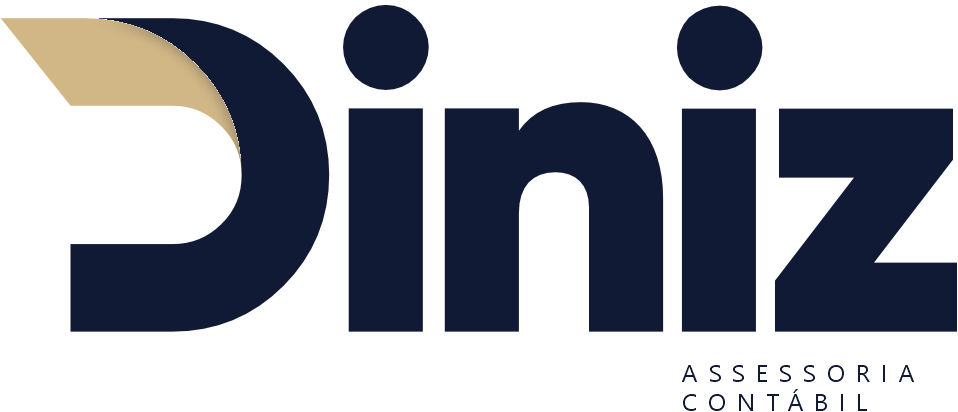
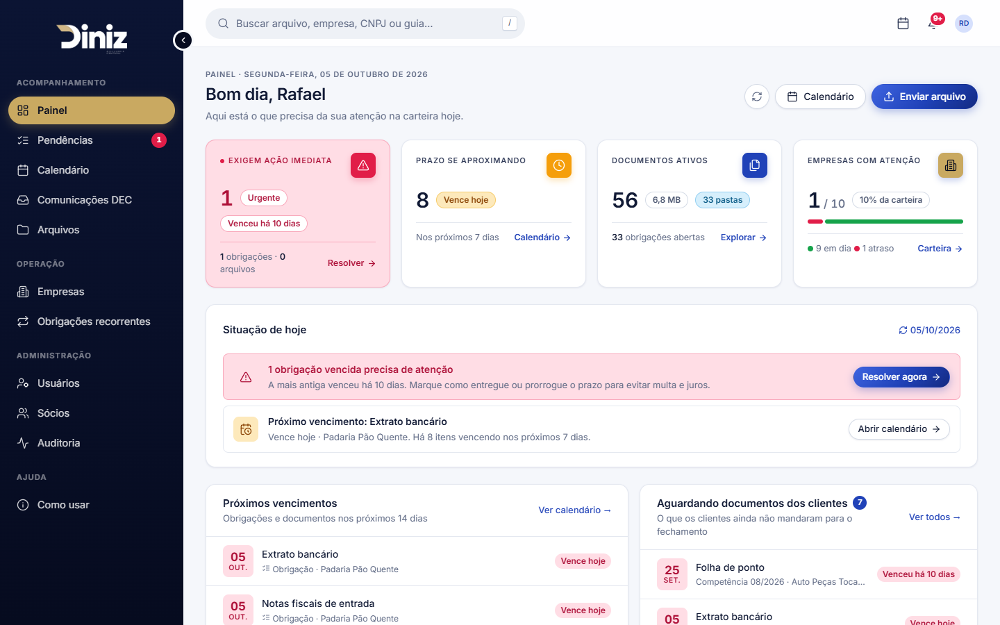
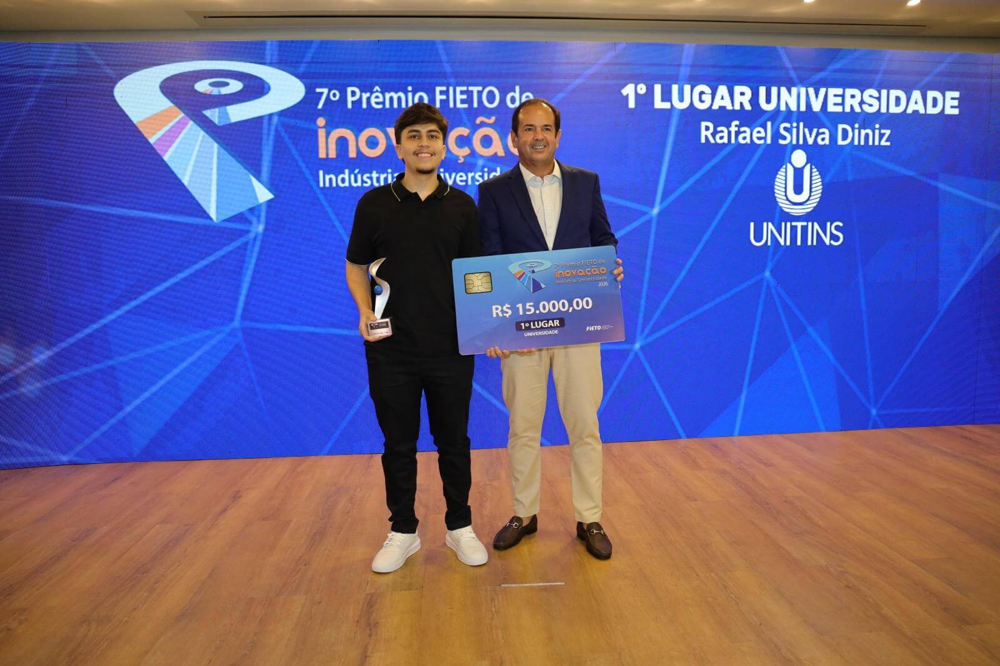
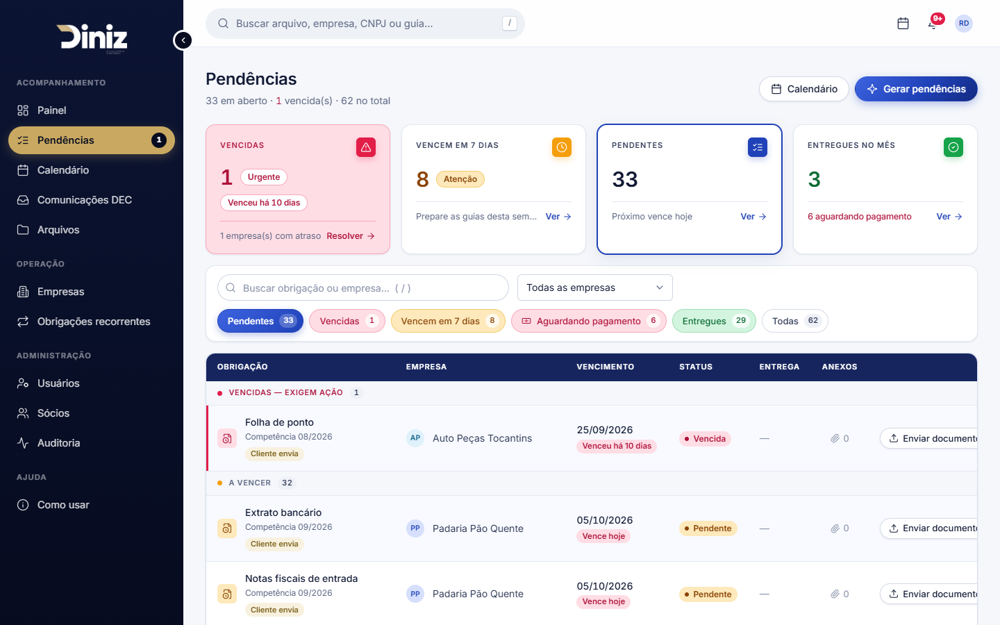
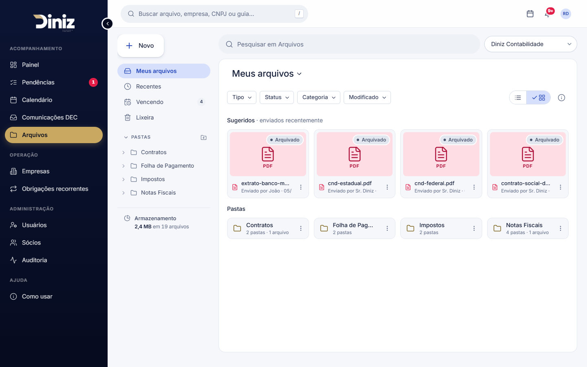
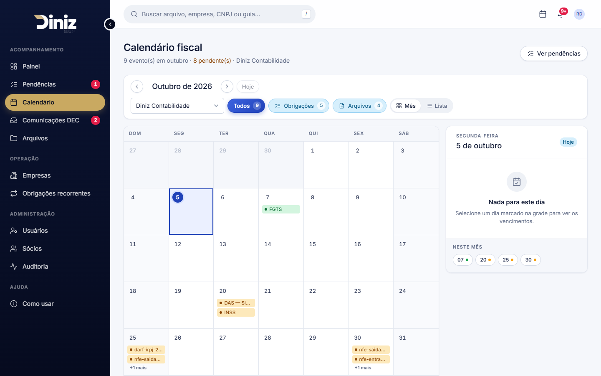
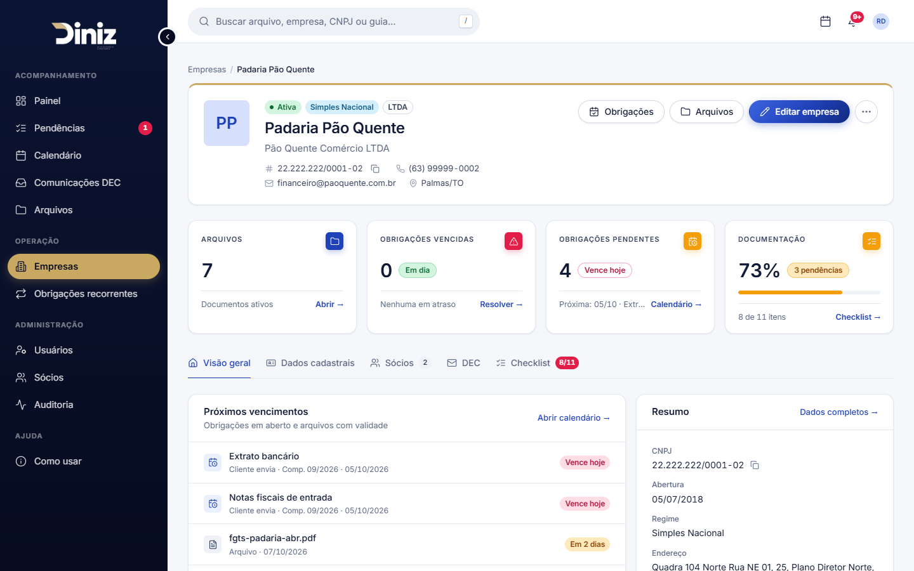

<div align="center">

<picture>
  <source media="(prefers-color-scheme: dark)" srcset="docs/img/diniz-logo-branca.png">
  
</picture>
&nbsp;&nbsp;&nbsp;&nbsp;&nbsp;&nbsp;
<picture>
  <source media="(prefers-color-scheme: dark)" srcset="docs/img/unitins-logo-branca.png">
  
</picture>

# 📅 Prazo Certo — Front-end

### Conformidade fiscal inteligente para empresas do Tocantins

**🏆 1º lugar no 7º Prêmio FIETO de Inovação, na categoria Universidade**

[](https://angular.dev)
[](https://www.typescriptlang.org)
[](https://www.chartjs.org)
[](#-recursos)
[](https://prazo-certo-to.vercel.app)

[**🌐 Demonstração**](https://prazo-certo-to.vercel.app) ·
[**⚙️ API (Quarkus)**](https://github.com/rafaelsdiniz/PrazoCerto-Quarkus) ·
[**📰 Notícia do prêmio**](https://www.unitins.br/nPortal/portal/noticias/detalhes/8509-2026-11-19-academico-da-unitins-conquista-1-lugar-na-categoria-universidade-do-7-premio-fieto-de-inovacao)

<br>



</div>

---

## 📖 Sobre

O **Prazo Certo** reúne num só portal os **documentos, prazos e obrigações fiscais** entre um escritório de
contabilidade (piloto: Diniz Assessoria Contábil, Palmas-TO) e as empresas clientes. Também traz automaticamente as
**comunicações da SEFAZ-TO** recebidas no Domicílio Eletrônico do Contribuinte (DEC), com a contagem da ciência tácita.

Este repositório é a **interface web**. A API, a arquitetura completa e a lista detalhada de funcionalidades estão no
[**PrazoCerto-Quarkus**](https://github.com/rafaelsdiniz/PrazoCerto-Quarkus).

## 🏆 Prêmio FIETO de Inovação

<div align="center">
  
  <br>
  <sub>Rafael Silva Diniz recebe o troféu de 1º lugar. Foto: Adilvan Nogueira</sub>
</div>

<br>

O projeto ficou em **1º lugar na categoria Universidade do 7º Prêmio FIETO de Inovação**, da Federação das Indústrias
do Estado do Tocantins, em 18 de novembro de 2026, entre 86 projetos inscritos. Foi desenvolvido na disciplina
**Projeto Integrador II** do curso de **Sistemas de Informação da Unitins**, com orientação da **Profª Stephanny Moraes**.

📰 [Matéria no portal da Unitins](https://www.unitins.br/nPortal/portal/noticias/detalhes/8509-2026-11-19-academico-da-unitins-conquista-1-lugar-na-categoria-universidade-do-7-premio-fieto-de-inovacao) ·
📸 [Post no Instagram](https://www.instagram.com/p/Df7NrjSh-Lo/)

## 🚀 Demonstração

Acesse **https://prazo-certo-to.vercel.app** com um dos logins abaixo (senha `123456`):

| Perfil | E-mail |
|---|---|
| Escritório (administrador) | `rafael@diniz.com.br` |
| Cliente | `maria@paoquente.com.br` |

Dentro do sistema, abra **Como usar** no menu lateral para seguir o roteiro de teste.

> [!NOTE]
> A API fica num servidor que desliga quando ninguém usa. **O primeiro acesso pode levar alguns segundos.**

## ✨ Recursos

| | |
|---|---|
| 📊 **Painel** | Banner com os destaques do dia e gráficos de vencimentos, entregas e saúde da carteira |
| ✅ **Pendências** | Obrigações do mês, confirmação de pagamento e mensagens por obrigação |
| 📅 **Calendário** | Todos os vencimentos do mês |
| 📬 **Comunicações DEC** | Mensagens da SEFAZ-TO com urgência e contagem da ciência tácita |
| 🗂️ **Arquivos** | Estilo Drive, com pastas por empresa, lixeira e leitura de guias por IA |
| 🏢 **Empresas e sócios** | Cadastro da carteira e quadro societário |
| 📜 **Certidões negativas** | Controle de validade das CNDs |
| 🧾 **Fechamento mensal** | Quadro por competência com responsável e prazo interno |
| 📈 **Relatórios** | Filtros por situação, responsável, regime e prazo, com saída em PDF e CSV |
| 🔁 **Obrigações recorrentes** | Modelos que geram as pendências automaticamente |
| 👥 **Usuários e auditoria** | Controle de acessos e histórico de ações |
| 💬 **Assistente virtual** | Chat em tela cheia e widget flutuante |
| 📱 **PWA** | Instalável no celular, com envio de documentos pela câmera |

## 🖼️ Telas

<table>
  <tr>
    <td></td>
    <td></td>
  </tr>
  <tr>
    <td align="center"><sub><b>Pendências</b></sub></td>
    <td align="center"><sub><b>Arquivos</b></sub></td>
  </tr>
  <tr>
    <td></td>
    <td></td>
  </tr>
  <tr>
    <td align="center"><sub><b>Calendário</b></sub></td>
    <td align="center"><sub><b>Empresa</b></sub></td>
  </tr>
</table>

## 🧰 Tecnologias

- **Angular 20**: componentes standalone, controle de fluxo `@if`/`@for` e lazy loading por rota
- **Design system próprio em CSS**, com tokens e componentes globais (veja o [DESIGN.md](DESIGN.md))
- **Chart.js / ng2-charts** para os gráficos
- **JSZip** e **FileSaver** para downloads
- Ícones [Lucide](https://lucide.dev) (licença ISC) e fonte [Inter](https://rsms.me/inter/)

## 💻 Rodando localmente

**Pré-requisitos:** Node.js 20+ e a [API](https://github.com/rafaelsdiniz/PrazoCerto-Quarkus) rodando em
`http://localhost:8080`.

```bash
git clone https://github.com/rafaelsdiniz/PrazoCerto-Angular.git
cd PrazoCerto-Angular
npm install --legacy-peer-deps
npm start
```

Acesse http://localhost:4200.

O endereço da API fica em `src/environments/environment.ts` (desenvolvimento) e
`src/environments/environment.prod.ts` (produção).

**Build de produção:**

```bash
npx ng build --configuration production
```

## ☁️ Publicação

Publicado na **Vercel** com o [`vercel.json`](vercel.json), que instala com `--legacy-peer-deps`, usa a saída
`dist/PrazoCerto/browser` e redireciona todas as rotas para o `index.html`.

## 📁 Estrutura do projeto

```
src/app/
├── components/   telas (painel, pendências, calendário, arquivos, empresas, DEC, ajuda…)
├── services/     chamadas à API
├── models/       contratos (DTOs) e enums
├── shared/       ícones, toasts, diálogo de confirmação, paginação, campos aprimorados
└── pipes/        formatação (CNPJ/CPF, telefone, prazos, tamanhos)
src/styles.css    design system (tokens e componentes)
```

## 👨‍💻 Autor

<table>
  <tr>
    <td align="center">
      <a href="https://github.com/rafaelsdiniz">
        <br>
        <b>Rafael Silva Diniz</b>
      </a><br>
      <sub>Sistemas de Informação · Unitins</sub>
    </td>
  </tr>
</table>

**Orientação:** Profª Stephanny Moraes, Universidade Estadual do Tocantins (Unitins), Câmpus Palmas.

**Referência de design:** [awesome-claude-design](https://github.com/VoltAgent/awesome-claude-design) (MIT), adaptada às
cores da marca Diniz.

---

<div align="center">
  <sub>Feito em Palmas, Tocantins 🌻</sub>
</div>
